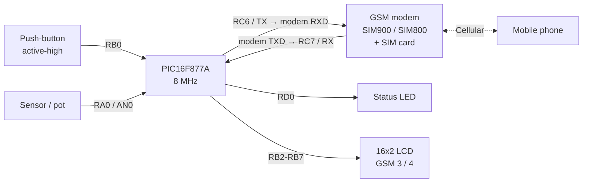
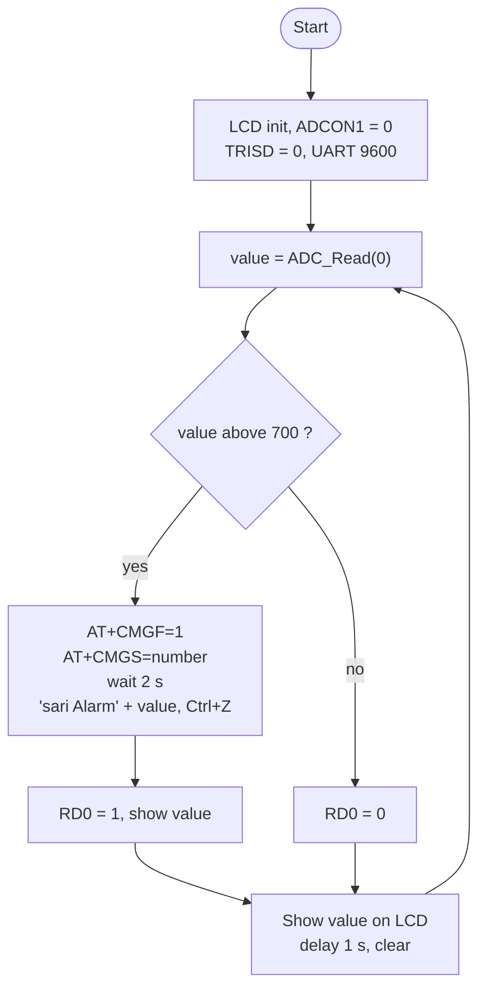

# Microcontroller-GSM-GPS

**GSM modem control** from a PIC16F877A with AT commands. The PIC places phone calls and sends SMS alerts when a button is pressed, when a sensor crosses a threshold, or when an SMS command arrives. The modem is a SIM900/SIM800-style module on the hardware UART.

## Target hardware & settings

| Setting | Value |
|---|---|
| Microcontroller | **PIC16F877A** |
| Clock | 8 MHz crystal (HS) |
| UART | **9600 baud, 8N1** (actual 9615 bps) to the GSM modem |
| Compiler / IDE | mikroC PRO for PIC (`UART`, `ADC`, `Conversions`, `C_String`, `Lcd`) |
| Config word | `0x2F4A`: HS oscillator, WDT off, PWRT off, BOR on, LVP off, no code protection |

## Wiring

| Signal | Pin |
|---|---|
| Modem RXD / TXD | RC6 (TX) / RC7 (RX) |
| Trigger button | RB0 (`TRISB = 0xFF`) |
| Analog sensor | RA0 / AN0 |
| Status LED | RD0 |
| LCD RS / E / D4–D7 | RB2 / RB3 / RB4–RB7 (GSM 3, GSM 4) |

## AT commands used

| Command | Purpose |
|---|---|
| `ATD<number>;` + CR LF | Dial a voice call |
| `AT+CMGF=1` | Put the modem in SMS **text** mode |
| `AT+CMGS="<number>"` + CR LF, wait 2 s, text, **Ctrl+Z (26)** | Send an SMS |
| `AT+CNMI=3,2,2,1,1` | Forward incoming SMS straight to the UART |

## Sub-projects

| Folder | What it does |
|---|---|
| `Test/` | UART check: echoes characters, `a`/`A` switches RD0. Used to test the modem link from a PC first. |
| `GSM 1/` | **Button → call**: while RB0 is high, sends `ATD<number>;` and lights RD0. `SendSMS()` is an empty stub. |
| `GSM 2/MyProject (2).c` | Same as GSM 1, but the dialling code is moved into a function. |
| `GSM 2/MyProject.c` | **Button → SMS**: `InitiGSM()` (`AT+CMGF=1`), then `AT+CMGS`, waits 2 s, sends "hi from sari" and Ctrl+Z. `SendCall()` is kept as an option. |
| `GSM 3/` | **Sensor alarm by SMS**: reads AN0 every second and shows it on the LCD. If the value is **> 700**, it sends an SMS "sari Alarm<value>" and lights RD0. |
| `GSM 4/` | **Remote query**: sets up the modem to forward incoming SMS to the UART. When a `T` arrives, it replies by SMS with the current AN0 reading. The LCD shows the live value. |
| `GSM function/` | Reusable helpers: `SendCall(number)` and `SendMSG(number, msg)` build the AT strings from parameters. |
| `GSM GPS/` | Empty placeholder (`main()` only) for the GPS part. |

### Program flow (`GSM 3`: SMS alarm)

### Notes
- **The destination phone number is hard-coded** in the source files. Change it before using the code yourself, and consider removing it before you make this repo public.
- `strcat("sari Alarm", Val)` writes into a string literal (undefined behaviour). Send the two parts with two `UART1_Write_Text` calls instead.
- In `GSM 3`, an SMS is sent **every second** while the value stays above 700. Add a flag so it sends only once per alarm.

## Build & flash
Open the `.mcppi` file of a sub-project in mikroC PRO for PIC, build, and flash the `.hex`. Power the GSM module from its own supply that can deliver 2 A bursts, and connect its GND to the PIC GND.
